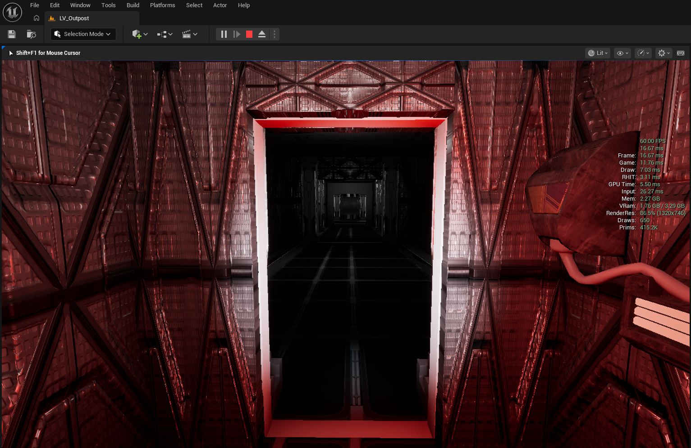
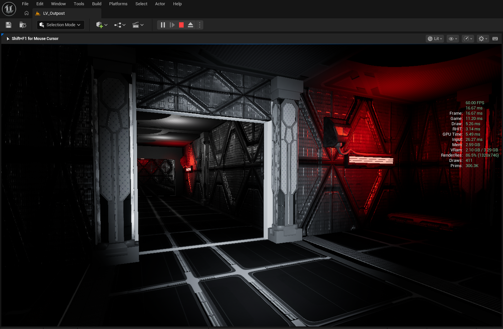
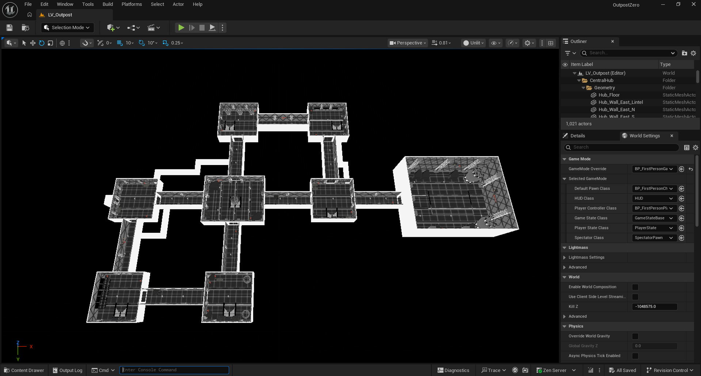
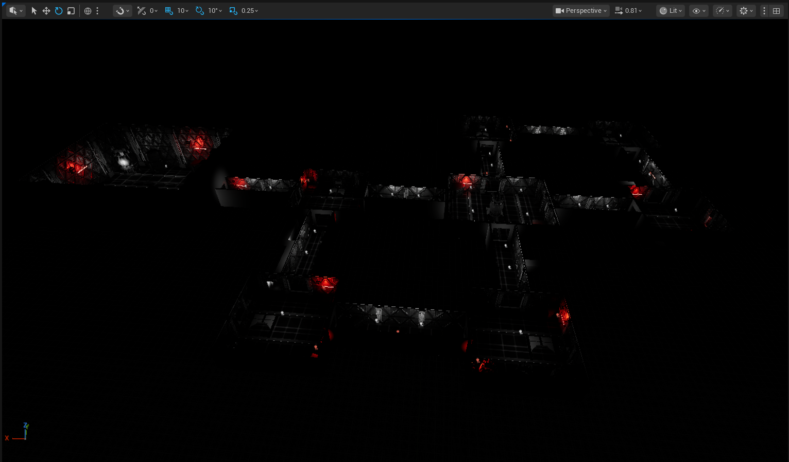
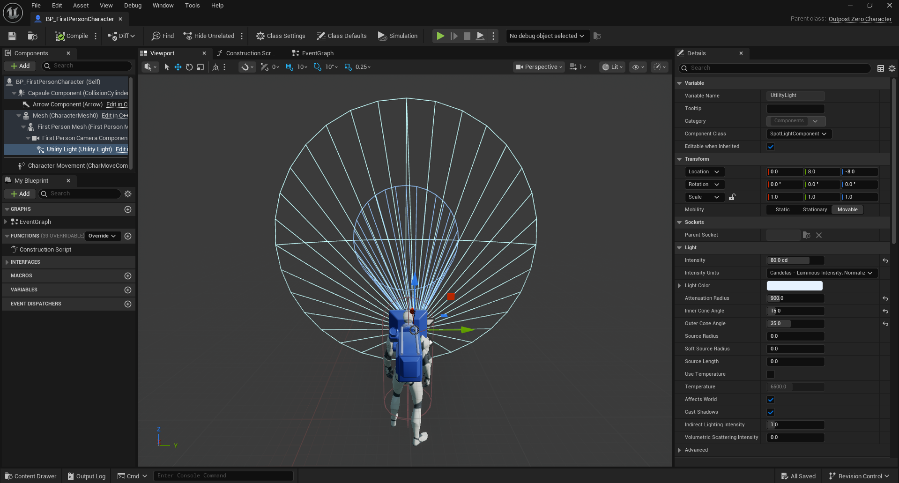
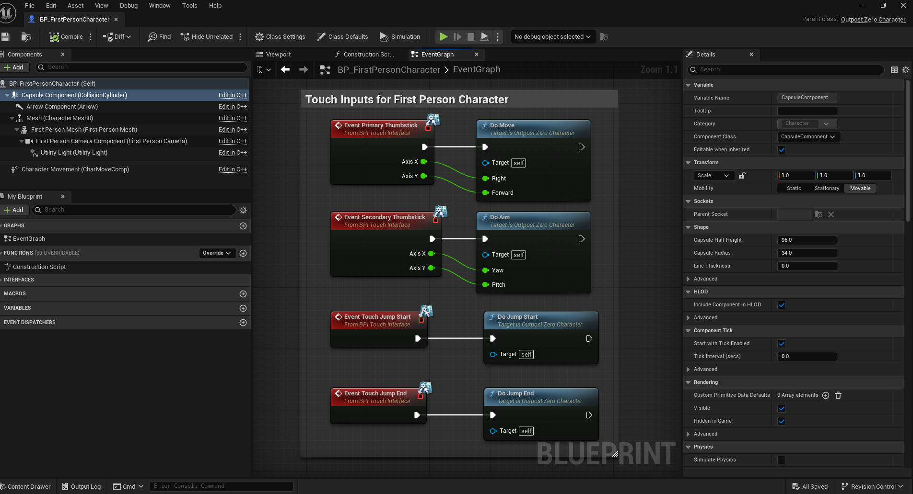

# OUTPOST ZERO

**A First-Person Sci-Fi Stealth Horror Experience**

**Outpost Zero v0.1 Alpha — In Development**

---

## About Outpost Zero

You wake alone in the maintenance alcove of a deep-space research station. The crew is missing. Emergency power has failed. The station is dark, silent, and something is still aboard.

Outpost Zero is a first-person sci-fi stealth horror experience built in Unreal Engine 5. The player must navigate a fully greyboxed and environment-dressed abandoned station, restore critical systems, and reach the hangar before — or despite — whatever is left inside.

The experience is built around atmosphere, careful exploration, and survival through stealth rather than combat. Near-total darkness, tight industrial corridors, crouch-only ventilation passages, and a single hostile entity that detects by sight make every step a decision.

---

## Gameplay

The intended objective sequence moves the player through the station in a deliberate order:

1. **Auxiliary Power** — restore emergency power to unlock terminals and essential systems
2. **Life Support** — restart air circulation before the station becomes uninhabitable
3. **Communications** — establish an outgoing signal
4. **Shuttle Preparation** — ready the escape vehicle
5. **Hangar Lockdown Override** — release the Security Control lockdown from the station's security room
6. **Escape** — board the shuttle in the Hangar

> **Note:** The full gameplay loop — interactions, objectives, AI, and ending — is not yet implemented. The current build contains the complete station environment, traversable map, and character movement systems.

Auxiliary power does not restore normal lighting. The station stays dark throughout the demo. Terminals and signage activate, but the emergency red lighting remains the primary ambient source.

---

## The Station

The entire game takes place in a single continuous map: `LV_Outpost`. There are no loading screens or separate levels.

The layout is built around a **Central Hub** that connects to eight rooms and nine corridors:

| Area | Description |
|---|---|
| **Starting Alcove** | Maintenance crawlspace off Crew Quarters. The player's starting position |
| **Crew Quarters** | Crew accommodation and emergency equipment storage |
| **Auxiliary Power** | Heavy electrical machinery and the main power console |
| **Life Support** | Central air filtration and control |
| **Communications** | Equipment racks and the outgoing signal console |
| **Security Control** | Monitoring station and hangar lockdown override |
| **Shuttle Preparation** | Pre-flight checks and equipment staging |
| **Hangar** | Large bay with reserved shuttle footprint and boarding approach |
| **Central Hub** | Connects all rooms via nine corridors |

Three **crouch-only ventilation passages** (Vent 1, Vent 2, Vent 3) provide alternate routes between areas, requiring the player to remain crouched for the entire traversal. These passages are physically built into the geometry — the ceiling is too low to stand.

---

## Environment and Atmosphere

The station was designed as a working industrial environment that has gone dark and quiet. Architecture follows a modular sci-fi kit: grated floors, exposed conduit, louvered vent panels, industrial columns, and wall-mounted equipment.

Lighting is minimal by design. Red emergency lights operate at low intensity throughout the station. Each room has only a handful of small fixtures, so the player's suit-mounted utility light is the primary source of illumination while moving and searching.

The environment does not use volumetric fog or expensive dynamic shadows. All room and corridor lights are movable point lights with no shadow casting, keeping the look consistent across the RTX 3050 target hardware.

---

## Current Alpha

The following systems are **implemented and traversable** in the current build:

- First-person character movement (walk, sprint, crouch)
- Stamina system (5 s sprint, 8 s recovery)
- Crouch with correct camera offset
- Suit-mounted utility light with F toggle
- Complete station environment (all eight rooms, nine corridors, hub)
- Three crouch-only ventilation passages
- Emergency lighting throughout the station

The following are **not yet implemented:**

- Interaction system
- Objectives and game loop
- Hostile entity AI
- Stealth mechanics and detection
- Shuttle extraction ending
- UI, HUD, menus
- Audio

---

## Game Components

### Character Controller

Movement is handled in C++ (`AOutpostZeroCharacter`). Walking (250 cm/s), sprinting (500 cm/s, Left Shift), and crouching (150 cm/s, Left Ctrl) are all custom implementations. Sprint drains a stamina pool over 5 seconds and locks out until 30% recovery. The standing capsule is 192 cm tall; crouching reduces it to 80 cm.

Sprinting is blocked while crouched, mid-transition, and when the standing capsule would not fit — such as inside a vent. Releasing Ctrl requests UnCrouch; the engine retries every frame until there is room to stand.

Jumping is disabled. The Space key is still mapped from the template but `CanJumpInternal` returns false unconditionally.

### Utility Light

The utility light is a `USpotLightComponent` attached directly to the first-person camera, offset 8 cm right and 8 cm down. It casts a 35° outer cone at 80 cd with a 900 cm attenuation radius and a 15° inner cone — enough to illuminate the space ahead without washing out the surrounding darkness.

The light is toggled by pressing F, bound to `IA_ToggleLight` via Enhanced Input. It is on by default and shows only while the pawn is player-controlled. Intensity, cone angles, attenuation radius, and colour are all configurable in Blueprint.

### Blueprint Event Graph

`BP_FirstPersonCharacter` extends the C++ `AOutpostZeroCharacter` class, combining reusable C++ gameplay functionality with Blueprint-based configuration and visual scripting. The Event Graph also retains input-related nodes inherited from the Unreal Engine First Person template.

Component property defaults — including utility light intensity, cone angles, and attenuation radius — are configured directly on the Blueprint's component instances. Logic that must be reliable at runtime — movement gating, stamina tracking, crouch camera correction — lives in C++.

### Level and Traversal

`LV_Outpost` is a single continuous BSP and static mesh level. All room geometry, corridor geometry, and ventilation passages are physically built into the map. There are no trigger volumes or scripted transitions; the vents are traversable purely because the ceiling is low enough to require crouching.

Room art actors are organized in a `Station/Art/` folder hierarchy per room (e.g. `Station/Art/CrewQuarters/Props/`), with subfolders for floors, walls, ceilings, props, and lighting.

---

## Development and Level Design

### Greybox First

The station was first built as a **greybox**: plain geometry at exact dimensions, with correct doorways, vent openings, and corridor widths, but no art. The greybox was used to verify room proportions, corridor connections, navigation clearances, and vent traversal — before any art was placed. This meant that movement feel, crouch clearances, and sightlines could all be tested and adjusted independently of visual dressing.

Once the greybox was approved, modular sci-fi assets were layered on top. Floor panels, wall cladding, ceiling tiles, columns, props, and lighting were placed room by room to transform the white geometry into a detailed industrial station. The Central Hub and all nine corridors were dressed and player-playtested before the remaining eight rooms were dressed in a single station-wide pass, followed by a station-wide manual walkthrough.

### Unreal MCP

Much of the environment dressing was driven by **Unreal MCP** (Model Context Protocol), a toolset that exposes editor operations to an AI assistant via structured tool calls. Rather than placing hundreds of actors by hand, repetitive tasks — tiling floor panels, cladding walls, positioning props, organizing the Outliner, configuring lights — were scripted as MCP tool sequences and executed in the live editor.

The workflow was: plan the room layout, write an MCP script to execute the placement, run it in the editor, then inspect and adjust manually. Manual inspection and Play In Editor sessions were used to validate every room after scripted dressing, checking for blocked doorways, floating geometry, and incorrect scales.

This approach allowed the entire eight-room station-wide environment pass to be completed with consistent naming, folder structure, and lighting conventions, while keeping the room layouts manually reviewable and correctable.

---

## Getting Started

**Requirements:** Unreal Engine 5.8.1 and Visual Studio 2022 with C++ development tools.

1. Open `OutpostZero.uproject` in Unreal Engine.
2. Allow Unreal Engine to compile any missing C++ modules.
3. Open `/Game/Maps/LV_Outpost`.
4. Press Play In Editor to explore the station.

### Controls

| Action | Input |
|---|---|
| Move | WASD |
| Look | Mouse |
| Sprint | Hold Shift |
| Crouch | Hold Ctrl |
| Utility Light | F |

---

## Development

**What is complete:** The station environment is fully greyboxed and environment-dressed across all rooms, with consistent lighting, organized actor hierarchy, and verified traversal. The character controller handles walk, sprint, stamina, crouch, and utility light. Three crouch-only vents provide alternate routing. The Central Hub and all nine corridors have been player-playtested and approved; the remaining eight rooms have undergone a station-wide manual walkthrough.

**What remains for a playable 5–10 minute experience:** The core gameplay loop needs interaction triggers, objective state management, and door control. A single sight-based hostile entity needs to be built with AI perception, patrol behaviour, and player-awareness state. Stealth mechanics — line-of-sight breaks, vent detection rules, and awareness persistence — need to be designed and implemented. The shuttle extraction ending, all UI and HUD elements, full audio pass, and final performance and visual polish are outstanding before the demo is ready to play.
